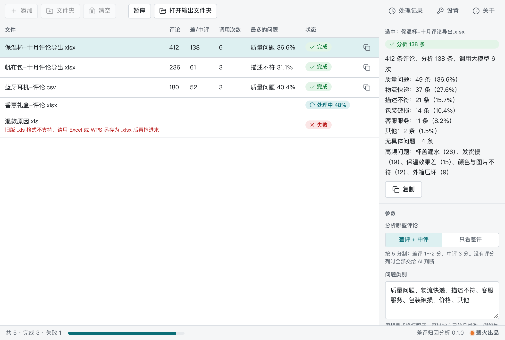

# 差评归因分析

> 篝火出品 · 收录于篝火 App 应用区

导入评论表格，AI 聚类出问题点和改进建议



## 下载

到 [Releases](https://github.com/campfire-code/review-insight/releases/latest) 下载对应安装包：

| 电脑 | 文件 |
|---|---|
| Windows 10 / 11 | `review-insight_版本号_windows-x64-setup.exe` |
| Mac（Apple 芯片） | `review-insight_版本号_mac-arm64.dmg` |
| Mac（Intel 芯片） | `review-insight_版本号_mac-x64.dmg` |

第一次打开：
- **Windows**：如果弹出「Windows 已保护你的电脑」，点「更多信息」→「仍要运行」。
- **Mac**：如果提示「无法验证开发者」，打开「系统设置 → 隐私与安全性」，在下方点「仍要打开」。

## 怎么用

**第一次用：先在「设置」里填大模型。** 打开「设置」，选一个服务商（推荐 DeepSeek 或通义千问，便宜、中文好），填上自己的 API 密钥和模型名。调用费用由你自己的账号承担，密钥只保存在本机。

1. 从店铺后台导出评论（.xlsx 或 .csv 都行，CSV 的 GBK 编码也能自动识别），拖进窗口。可以一次拖多个文件，最后合并成一份报告。
2. 「分析哪些评论」：默认分析差评和中评（按 5 分制，1～2 分是差评、3 分是中评；10 分制、100 分制会自动换算；「★★☆☆☆」「差评/中评/好评」这类文字也能识别）。没有评分列时，全部评论交给 AI 判断，好评记为「无问题」，不计入占比。
3. 「问题类别」默认是：质量问题、物流快递、描述不符、客服服务、包装破损、价格、其他。可以按自己的品类改，比如服装加上「尺码偏差」。AI 只会在这些类别里选。
4. 评论列、评分列一般能自动认出；认不出时在参数里填列名或列字母。没有评分列就在「评分在哪一列」填「无」。
5. 点「开始处理」。每个文件处理完，表格里显示评论数、差/中评数、**调用大模型的次数**和占比最高的问题；点一行，右侧能看到这个文件的分类明细。
6. 全部处理完自动生成报告 Excel（一个文件时叫「原文件名-差评归因报告.xlsx」，多个文件时叫「差评归因报告.xlsx」，名字可在参数里改）：
   - **汇总**：评论总数、分析条数、调用次数；各类别条数和占比；高频问题 TOP10（次数、所属类别、典型评论）；改进建议。
   - **明细**：每条差评 / 中评的行号、评分、原文、问题类别、问题点、原因摘要（多个文件时多一列来源文件）。

**费用控制**
- 每 25 条评论合成一次调用（同时最多 2 次），最后再调用 1 次生成改进建议。比如 138 条差评中评约调用 7 次。
- 「最多分析多少条」默认 1000 条，超过的部分不分析，结果里会写明。
- 模型漏掉个别评论时，只把漏掉的那几条再问一次；某一批失败不影响其他批次。没有设置大模型或密钥不对时，立刻停下并提示去「设置」检查。

## 验收用例

需要先在「设置」里填好可用的大模型。大模型的归类每次可能略有不同，下面核对结构和数量。

| 操作 | 应得到 |
|---|---|
| 拖入 `samples/评论导出.xlsx`（60 条评论，其中 1～3 分 36 条），默认参数，点「开始处理」 | 表格这一行显示：评论 60、差/中评 36、调用次数 2；完成提示「共分析 36 条差评 / 中评，调用大模型 3 次（含 1 次生成改进建议）。报告：…/评论导出-差评归因报告.xlsx」 |
| 打开上面的报告 | 有「汇总」「明细」两个工作表。汇总里有「大模型调用次数 3」、7 个类别的条数和占比（不含「无问题」的条数加起来 = 100%）、高频问题 TOP10、3～6 条改进建议。明细 36 行，每行都有问题类别、问题点和原因摘要 |
| 点「清空」，「分析哪些评论」改「只看差评」，重新拖入同一文件处理 | 差/中评 24、调用次数 1 |
| 拖入 `samples/评论-无评分列.csv` 处理 | 右侧说明里有「没有评分列，由 AI 判断是否差评」；两条好评归为「无具体问题」，不计入占比 |
| 「设置」里清空密钥后处理 | 显示失败：「还没有设置大模型：请到「设置」里填写接口地址、密钥和模型名」 |
| 「评论在哪一列」填 `留言` | 显示失败：「找不到列「留言」，表头是：订单号、商品、评分、评论内容、评价时间」 |

自动测试（`pnpm test`）用假的大模型回复跑通了完整流程，包括回复带代码块、顶层数组、中文键名、缺编号、漏掉评论补问、建议生成失败仍出报告等情况。

## 自己编译

需要 Node.js 22、pnpm、Rust。

```bash
pnpm install
pnpm test          # 单元测试
pnpm tauri dev     # 开发运行
pnpm tauri build   # 打包
```

界面框架在 `src/kit`（所有 campfire-code 工具共用），本工具的逻辑在 `src/tool`。

## 归属

本工具由**篝火**出品，是篝火 App 应用区收录的开源工具之一，由篝火（GitHub 组织 [campfire-code](https://github.com/campfire-code)）维护与更新。全部工具的目录见 [toolkit-hub](https://github.com/campfire-code/toolkit-hub)。

## 许可证

MIT，版权方为篝火（campfire-code）。
